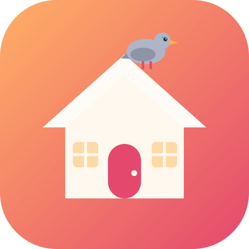
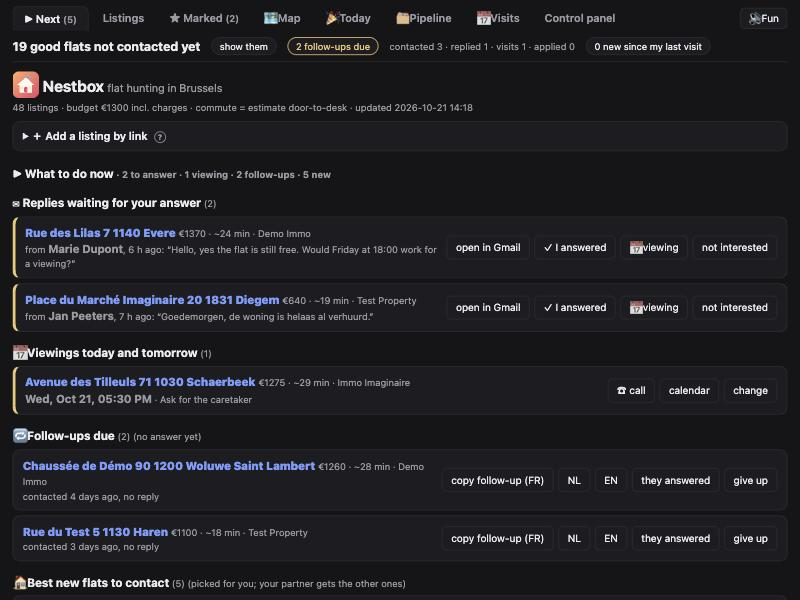
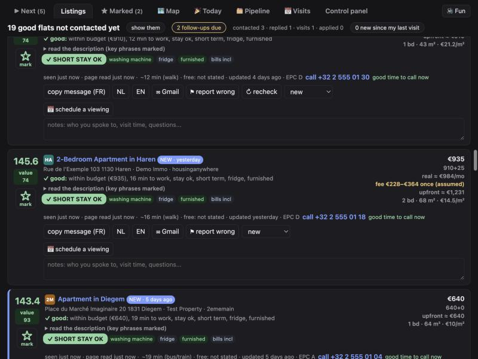
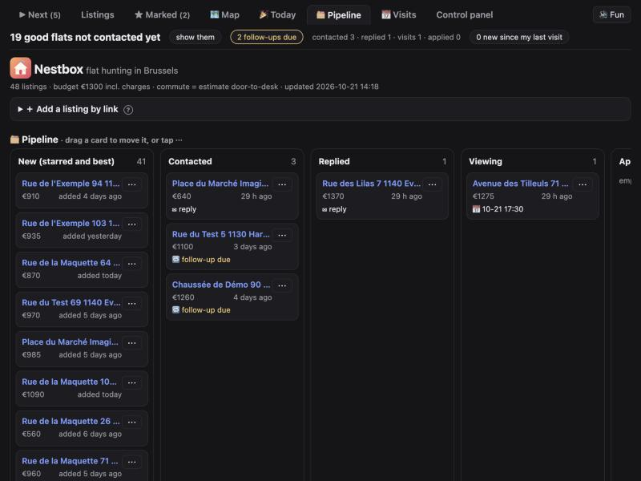
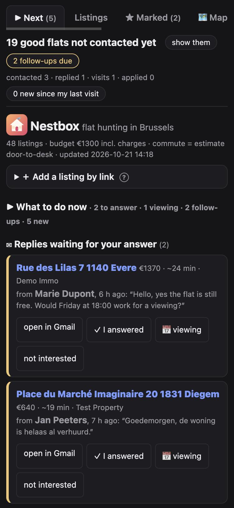

<p align="center"></p>

# Nestbox

**Find a flat in Brussels before the pigeons take it.**

Nestbox is a small tool that hunts for rental flats for you, ranks them, tells you what to do next (who to call, who to follow up, who replied) and nags you, politely or not, until you have a roof.

It was built by an intern who arrived in Brussels with a hostel bed, a budget and a deadline, and found out that flat hunting is a part-time job. This is a **hobby project, not a product**. It works on my laptop. It might work on yours. 🐦

<p align="center"></p>

## What it does

- 🔎 **Looks at five sites for you** (Immoweb, Immovlan, 2ememain, HousingAnywhere, Spotahome), a few times a day, politely.
- 🧠 **Reads the ads in French, Dutch and English** and notices what matters: shared kitchen, minimum one-year lease, "registration not possible", students only, fridge, washing machine, short stays welcome... Optionally Gemini double-checks the descriptions.
- 🏁 **Ranks flats** with a score you can understand, and says in one line *why* a flat is (or is not) good.
- ▶ **Tells you what to do now.** One page: replies waiting for your answer, viewings today, follow-ups due, the best new flats to contact.
- 🔎 **Search bar** on every page: find a flat by a phone number (any spelling), an email address, a street, a word from the ad, your notes or your mail.
- ✉ **Writes the first message** in French, Dutch or English (you can edit the texts), with copy, WhatsApp and Gmail buttons.
- 📬 **Watches your Gmail (read-only)** and shows landlords' replies on the right flat.
- 📅 **Keeps your viewings** and exports them to your calendar.
- 🗂 **Pipeline board**: new → contacted → replied → viewing → applied → rejected. Drag cards around.
- 🌅 **Morning summary** notification. And an "I found a flat" button that makes everything shut up.
- 📱 Works on a phone. Optional shared copy so a friend can look too.
- 🎭 A **fun layer** (sounds, voices, memes, a pigeon, dark humor) to keep two tired people motivated. It is optional and there is a Quiet button.

<p align="center">
 <br>

</p>

## Try it in 30 seconds

You need Python 3.9 or newer. Nothing to install.

```bash
git clone https://github.com/Hajorda/nestbox.git
cd nestbox
python3 demo.py
```

That opens a demo with **made-up listings** at http://127.0.0.1:8766/ so you can click around. Your real data is never touched.

## Use it for real

```bash
python3 serve.py
```

Open http://127.0.0.1:8765/. The first time, it asks a few questions (your name, budget, dates, areas). Then press **Scrape now** in the control panel (the first run takes about 10 minutes; later runs are faster because only new or changed listings are read).

A typical day:

1. Open **▶ Next**. Answer the replies, go to your viewings, send the follow-ups.
2. Contact the best new flats (one tap to copy the message, one tap for Gmail, WhatsApp or the phone).
3. Mark what happened. Nestbox keeps a history for every flat.
4. Found one? Press **🏠 this is the one**. Searching and reminders stop, nothing is deleted.

## Optional extras

Everything below is optional. Each one has a step-by-step in the control panel.

| Extra | What you get | What you need |
|---|---|---|
| **Gemini** | Double-checks tricky descriptions | A free API key in a `.env` file |
| **Gmail link** | Replies show on the right flat | A Google Cloud OAuth client (10 minutes, read-only access) |
| **Shared copy** | A friend sees the list and the notes; phone notifications; points and pictures for the fun layer | A small server. [Step-by-step for Railway](docs/SHARED_COPY.md) |
| **Notifications** | Hourly nudges and the morning summary on your phone | The shared copy, and a browser that allows them |

## The honest bits

- **It scrapes websites.** It follows each site's robots.txt, goes slowly, one request at a time per site, and reads each listing page once. Following robots.txt is good manners, but it is **not a legal guarantee**: a site's terms of use may still forbid scraping, and listings contain other people's data (agents' names and phone numbers). This is for **personal use**, at your own risk, and not legal advice. Don't hammer anyone.
- **Scrapers break.** Sites change their pages. When a site suddenly returns nothing, Nestbox shows a red bar saying so instead of quietly showing fewer flats. When that happens it needs a fix.
- **It has only been tested in Brussels.** On the first screen it asks for your name, budget, move-in and move-out dates, workplace and areas; flats that are free too long after your move-in are flagged. The areas, the commute estimates (to EUROCONTROL in Haren) and the message texts are Brussels-specific, so other cities would need work.

- **The ads are read by keywords** (plus Gemini if you use it). It is good, not perfect. The flags say where in the text they found the thing, so you can check. Always read the real ad before you send money.
- **Scams exist.** A "reply" from a Gmail address that sounds like a rental platform is marked as spam. Never pay a deposit before you have seen the flat and the contract.
- **Your data stays on your computer.** Email text never leaves your Mac. The shared copy (if you use it) only gets statuses, notes and the page.

## The fun layer, and the Quiet button

Sounds, spoken pep lines, memes, streaks and a weekly league, a 10-minute "just start" timer, a pigeon that walks across your screen, fake ads, sleepy faces and a leave-the-site guilt trip. It is meant to be funny with a friend, and it has dark humor about being homeless, because that is where the author's head was. Your own face and memes can be uploaded (none are included).

- It is **optional**, and the **🔊 Fun / 🔇 Quiet** button (or the `q` key) turns all of it off at once. Every part also has its own switch.
- The points, streaks and pictures need the [shared copy](docs/SHARED_COPY.md); the toys work without it.
- Everything it does is listed in [docs/FUN.md](docs/FUN.md).

## Keyboard

`j` / `k` move between flats, `m` marks, `o` opens the ad, `c` copies the message, `/` searches, `?` shows the list.

## For tinkerers

- Plain Python 3 standard library, no packages. One HTML page, no build step.
- Run the tests: `python3 test_describe.py && python3 test_mail_link.py && python3 test_core.py`
- The technical notes (how scoring works, files, settings) are in [docs/DETAILS.md](docs/DETAILS.md). Sharing with a friend: [docs/SHARED_COPY.md](docs/SHARED_COPY.md). The fun layer: [docs/FUN.md](docs/FUN.md).
- Bugs and ideas are welcome, no promises. 🐦

## License

[MIT](LICENSE). Use it, change it, share it. No warranty, and you are responsible for how you use it (see "The honest bits").
